<p align="center">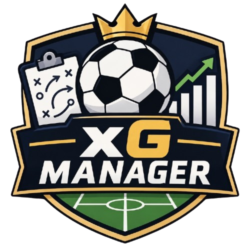</p>

# xG Manager

Juego de gestión de fútbol en **Pygame** para el ramo de Minería de Datos. Diriges un club de una de las 5 grandes
ligas durante una temporada completa (datos reales de **EA SPORTS FC 24**, Kaggle) y un asistente basado en modelos
de minería de datos te ayuda a decidir.

## Capturas

| | |
|---|---|
| 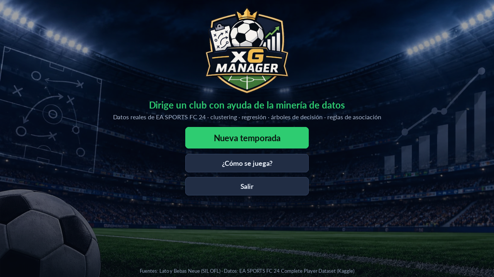 **Menú principal** | 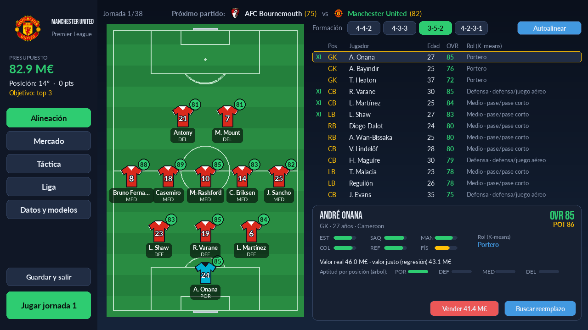 **Alineación** (asignación óptima con algoritmo húngaro) |
| 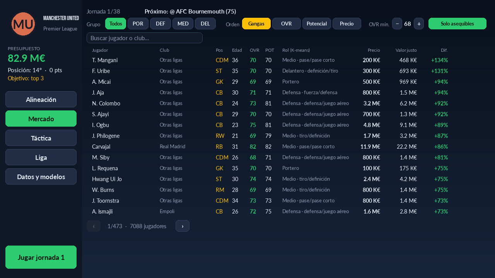 **Mercado** (gangas según la regresión) | 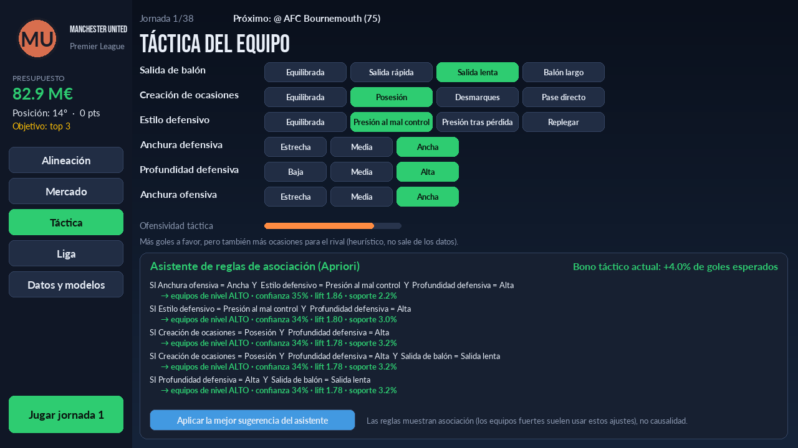 **Táctica** (reglas Apriori) |
| 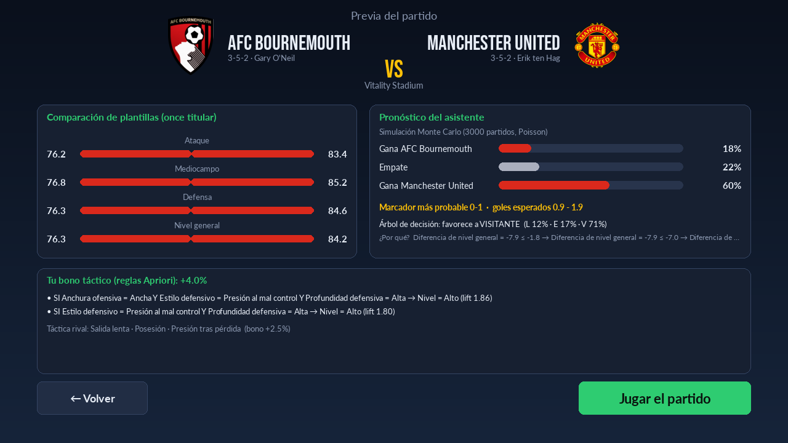 **Previa** con pronóstico y árbol de decisión | 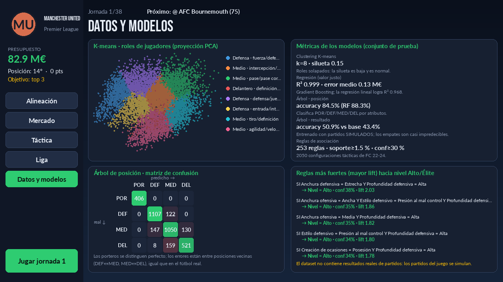 **Datos y modelos** (K-means, métricas) |
| 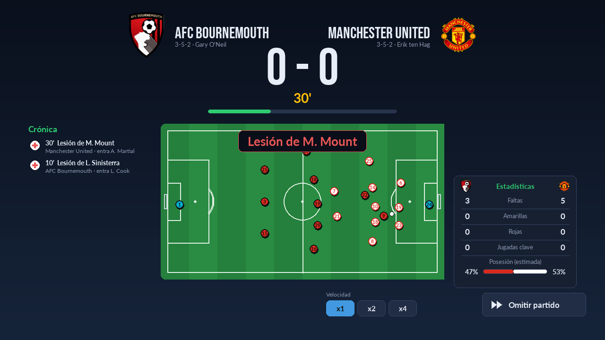 **Partido en vivo**: crónica, estadísticas y velocidad | 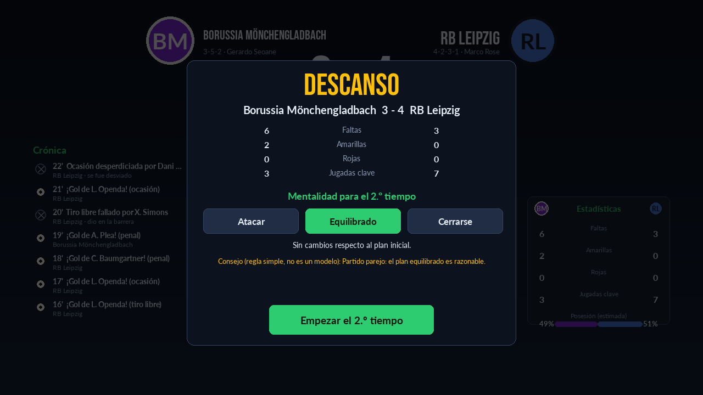 **Descanso**: elige la mentalidad del 2.º tiempo |
| 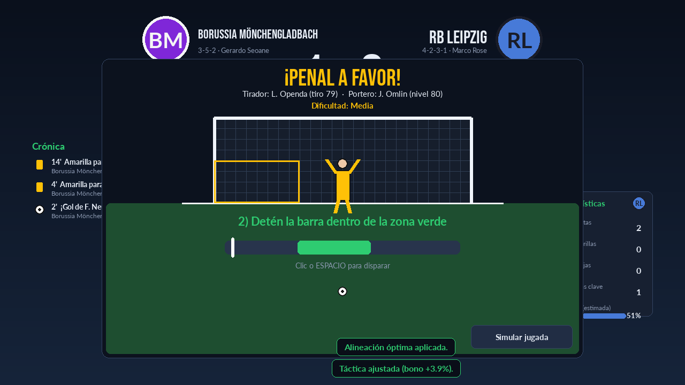 **Penal a favor**: elige zona y detén la barra | 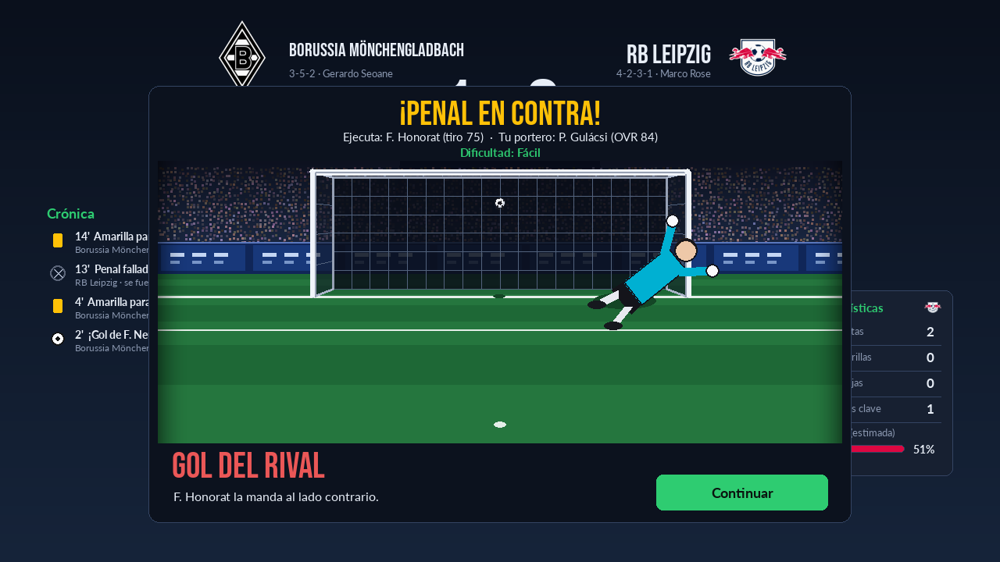 **Penal en contra**: elige hacia dónde lanzarte |
| 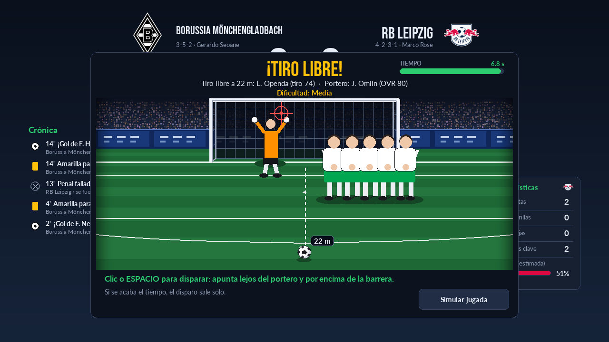 **Tiro libre** con barrera | 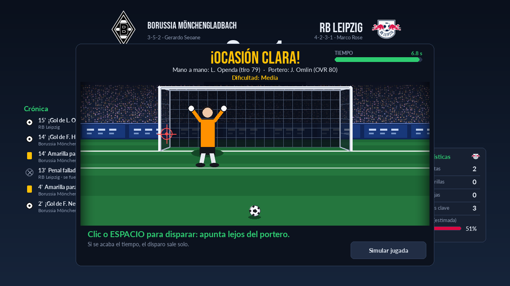 **Ocasión clara**: apunta lejos del portero |

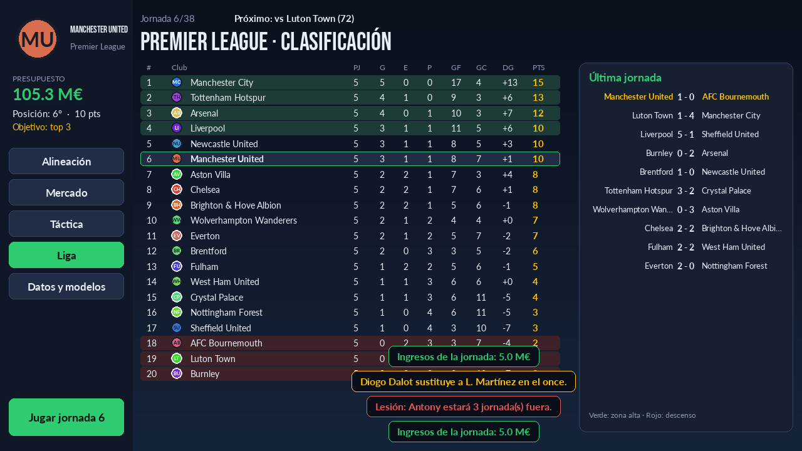

## Cómo ejecutarlo

Requisitos: **Python 3.12** (probado en Windows 11) y unos 20 MB de disco.

```powershell
git clone https://github.com/P1POX/xG-Manager.git
cd xG-Manager
python -m venv .venv
.\.venv\Scripts\Activate.ps1
pip install -r requirements.txt
python main.py
```

En macOS/Linux, el entorno se activa con `source .venv/bin/activate`. Si PowerShell bloquea la activación, ejecuta antes
`Set-ExecutionPolicy -Scope Process RemoteSigned`. Si la ruta de la carpeta es muy larga en Windows, puede fallar la carga de DLL: clónalo en una ruta corta (p. ej. `C:\dev`).

**Escudos de los clubes (opcional).** Descárgalos una vez con `python tools/descargar_logos.py` (necesita `git` y baja unos 17 MB;
se guardan en `assets/logos/`, que no se sube a Git). Si no los descargas, el juego dibuja un escudo genérico con las iniciales.

Los datos ya procesados y los modelos entrenados vienen incluidos (`data/`, `models/`, `reports/`). Para regenerarlos
desde los CSV originales de Kaggle (`male_players.csv`, `male_teams.csv`, `male_coaches.csv`):

```powershell
python ml/preparar_datos.py "C:/ruta/a/archive"
python ml/entrenar.py
```

**Guardar y continuar.** La temporada se guarda sola al cerrar cada jornada, al pulsar *Jugar jornada* y al cerrar la ventana
desde el hub; también puedes usar **Guardar y salir** (barra lateral). Al abrir el juego aparece **Continuar temporada** con
el resumen de la partida. Hay un solo guardado, en `%APPDATA%\xG-Manager\partida.json` (Windows), `~/Library/Application Support/xG-Manager/`
(macOS) o `~/.local/share/xG-Manager/` (Linux). Un partido a medias no se guarda: al continuar vuelves al inicio de esa jornada.
Para empezar de cero basta con pulsar dos veces *Nueva temporada* (o borrar ese archivo).

Pruebas (sin ventana, con clics simulados; guardan capturas en `shots/` y nunca tocan tu partida guardada):

```powershell
python tests/test_flujo.py      # pulsa los botones de menús, hub, partido, minijuegos y descanso
python tests/test_guardado.py   # guarda, carga y comprueba que la partida continúa igual
python tests/test_cancha.py     # partidos completos: la animación coincide con la crónica y nadie sale de la cancha
python tests/smoke_test.py      # simula una temporada completa
```

## Jugabilidad

1. Elige liga (Premier, La Liga, Bundesliga, Serie A, Ligue 1) y club. La directiva fija un objetivo de posición.
2. **Alineación:** elige formación, coloca titulares (clic en un puesto y luego en un jugador) o usa *Autoalinear*.
3. **Mercado:** ficha jugadores con tu presupuesto, vende, o pide *Buscar reemplazo* para un jugador.
4. **Táctica:** 6 ajustes tácticos; el asistente te muestra qué reglas cumplen y su bono.
5. **Jugar jornada:** previa con pronóstico y partido en vivo (dura ~1 minuto a velocidad x1) sobre una cancha animada estilo
   Haxball: los 22 jugadores se mueven según su formación, la pelota pasa entre ellos y el campo "actúa" cada gol, falta,
   tarjeta y lesión de la crónica (la animación es solo presentación: el resultado lo decide siempre `juego/eventos.py`).
   Hay faltas, tarjetas amarillas y rojas
   (la expulsión te deja con 10 y el jugador se pierde el siguiente partido), lesiones con sustitución automática,
   estadísticas, velocidad x1/x2/x4 y botón **Omitir partido**.
6. **Jugadas clave (minijuegos):** los penales, tiros libres y ocasiones claras se juegan tú mismo. La dificultad depende
   de las estadísticas: cuanto mejor sea el tiro del ejecutor frente al nivel del portero rival, más lenta es la barra o el
   puntero y más pequeño el alcance del portero. En un penal en contra eliges hacia dónde lanzarte (el tirador tiene una
   tendencia hacia un lado, es la pista). Cada minijuego tiene el botón *Simular jugada*, que decide con la probabilidad del
   modelo (`juego/eventos.py`).
7. **Descanso:** eliges la mentalidad del 2.º tiempo (Atacar, Equilibrado, Cerrarse), que cambia los goles esperados de
   ambos equipos; el consejo que se muestra es una regla simple, no un modelo.

## Dónde entra cada técnica de minería de datos

| Técnica | Archivo | Qué hace en el juego |
|---|---|---|
| **Clustering (K-means, k=8)** | `ml/entrenar.py` | Asigna un *rol* a cada jugador de campo (p. ej. "Delantero · definición/tiro"). *Buscar reemplazo* devuelve los jugadores más cercanos en el espacio de atributos. Se elige k con codo + silueta. |
| **Regresión** (lineal vs Gradient Boosting) | `ml/entrenar.py` | Predice el *valor justo* de un jugador. En el mercado, `valor justo / precio pedido` define las "gangas". |
| **Árbol de decisión (posición)** | `ml/entrenar.py` | Predice POR/DEF/MED/DEL a partir de 40 atributos. Se usa como *aptitud*: un jugador fuera de su posición natural rinde menos según la probabilidad que da el árbol. |
| **Árbol de decisión (resultado)** | `ml/entrenar.py` | Predice local/empate/visitante a partir de diferencias de ataque, medio y defensa. En la previa muestra el camino de reglas ("¿Por qué?"). |
| **Reglas de asociación (Apriori)** | `ml/entrenar.py`, `juego/asistente.py` | Sobre 2050 configuraciones tácticas de FC 22-24: `{ajustes tácticos} → Nivel del equipo`. Las reglas aplicables dan un bono de ±6 % de goles esperados y alimentan la sugerencia táctica. |
| **Evaluación** | `reports/` | Accuracy, matriz de confusión, R², MAE, silueta, soporte/confianza/lift, reglas del árbol exportadas. |

## Limitaciones que conviene explicar en el informe

- **El dataset no trae resultados de partidos** (solo jugadores, equipos y entrenadores). Por eso el partido se simula con un modelo
  de Poisson alimentado por el once real, y el árbol de resultado se entrena con **partidos simulados**: explica la
  simulación, no el fútbol real. Su accuracy (~51 %) frente a la línea base (~43 %) refleja que los empates son casi impredecibles.
- **La regresión llega a R² ≈ 0.999** porque el valor de mercado de FIFA se calcula con una fórmula sobre rating, potencial
  y edad: el modelo aprende esa fórmula.
- **La silueta de K-means es baja (~0.15)**: los roles se solapan de forma natural (un lateral y un extremo comparten atributos).
- Las reglas de asociación muestran **asociación, no causalidad**: los equipos fuertes usan ciertos ajustes porque son fuertes.
- La ofensividad táctica y los pesos de ataque/defensa del motor de partidos son **heurísticos** (no salen de los datos).
- Las tasas de faltas, tarjetas, lesiones, penales y tiros libres (`juego/eventos.py`) son **supuestos razonables**, no se
  estimaron con datos reales; el 25 % de los goles esperados se reparte entre balón parado y ocasiones para mantener el
  promedio de goles por partido (~2.7).

## Estructura

```
main.py                 punto de entrada
ml/preparar_datos.py    limpieza y filtrado de los CSV de Kaggle
ml/entrenar.py          clustering, regresión, árboles y reglas; guarda modelos y métricas
juego/                  modelo.py · simulacion.py · eventos.py · minijuegos.py · cancha.py · guardado.py · camisetas.py · asistente.py · datos.py · tactica.py · ui.py · app.py
tools/                  descargar_logos.py (escudos de clubes y logos de ligas, opcional)
tests/                  test_flujo.py · test_guardado.py · test_cancha.py · smoke_test.py
assets/fonts/           Lato y Bebas Neue (SIL Open Font License)
data/ models/ reports/  datos procesados, modelos y métricas
```

## Licencia

El **código** se distribuye bajo licencia MIT (ver [LICENSE](LICENSE)). Los **datos** derivados de EA SPORTS FC 24 (nombres, valoraciones,
clubes) no son parte de esa licencia: pertenecen a sus titulares y se usan solo con fines académicos y no comerciales. Las fuentes
conservan su licencia SIL OFL.

## Créditos

- Datos: *EA SPORTS FC 24 Complete Player Dataset* (Kaggle, stefanoleone992); los nombres de clubes y jugadores pertenecen a sus titulares.
- Fuentes: [Lato](https://fonts.google.com/specimen/Lato) y [Bebas Neue](https://fonts.google.com/specimen/Bebas+Neue), licencia SIL OFL (`assets/fonts/OFL.txt`).
- Escudos (opcionales): los baja `tools/descargar_logos.py` del repositorio público [luukhopman/football-logos](https://github.com/luukhopman/football-logos); pertenecen a sus clubes y se usan solo con fines educativos.
- Camisetas y campo se dibujan por código; el repositorio no incluye imágenes de terceros.
